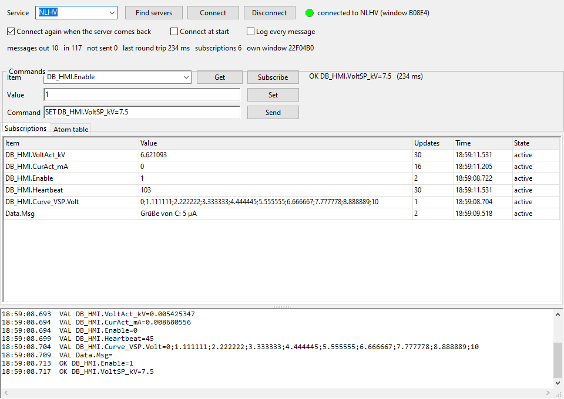

# Atom Client (Lazarus)

A client for the [AtomServer](../AtomServer/README.md): commands and values go between the programs as **Windows global atoms** (protocol NLAtom/1). It is written in Free Pascal / Lazarus with normal forms, and needs no DLL and no network. It also shows the whole global atom table of the Windows session.



## Build and run

Open `AtomClient.lpi` in Lazarus and press Run, or:

```bash
C:\lazarus\lazbuild.exe AtomClient\AtomClient.lpi
```

Start the AtomServer, then press **Connect** (`F5`). Choose an item and press **Get** or **Subscribe**.

## Window

- **Connection:**
  - **Service:** **Find servers** (`F7`) lists every running AtomServer (service, window, program).
  - **Connect** finds the server's window, says `HELLO` and reads the item list (`ITEMS`). **Disconnect** (`F6`) says `BYE`.
  - **Connect again when the server comes back**, **Connect at start**, **Log every message** (the raw messages with their ids).
  - The status line shows messages out / in, messages not sent, the last round trip, the subscriptions and the client's own window.
- **Commands:**
  - **Item** (`Enter` = Get), **Get**, **Subscribe**.
  - **Value** and **Set** (`Enter`). Curves are values separated by `;`.
  - **Command:** any command, for example `PING`, `ITEMS Curve`, `UNSUB *`, `SET Data.Note=hi`.
  - The reply appears on the right with its round trip time; errors are red.
- **Subscriptions tab:** item, value, number of updates, time, state (waiting, active, refused with the reason).
  - **Double-click** a row: its item and value go to Set.
  - Right-click: *Copy value*, *Unsubscribe* (`Del`), *Unsubscribe all*.
- **Atom table tab:** every string atom in the global atom table (number and text). The table belongs to the whole Windows session, so it also has the atoms of other programs.
  - **Filter** by text.
  - **Only NLAtom messages:** atoms that look like an NLAtom message (`<id> <WORD>`). After the messages are handled there should be none; one that stays means a program didn't delete it.
  - The table holds about 16,000 strings.
- **Log:** connects, replies, lost and found servers.

The settings and subscriptions are saved in `AtomClient.ini` next to the exe.

## When the server ends

- **The server stops:** it says `BYE`, and the client knows at once.
- **The server crashes:** the client sees that its window is gone within 100 ms.
- **The server comes back:** the client looks for the service every 2 s. When it finds it, it says `HELLO` and sends all subscriptions again.

## Command line (for tests and scripts)

```
--service=NLHV --find --connect --sub=DB_HMI.VoltAct_kV,Data.Msg
--set=DB_HMI.VoltSP_kV=7.5 --get=DB_HMI.VoltSP_kV "--raw=ITEMS Curve" --atoms
--dump=<file.txt> --after=<s>       replies, subscriptions and log to the file, then exit
--snapshot=<file.png>               the window as a PNG (with --after)
```

A run with `--dump` doesn't load or save the subscriptions of `AtomClient.ini`.

## Test that was run

With the AtomServer and an independent Python client (see the server's README):
- **Client A:**
  - 4 subscriptions (one of them unknown, which was refused), a `SET`, a curve `GET` and a `PING`;
  - B and D set `Data.Msg` (`Grüße von B: 5 µA`, then `after the restart`), and A's subscription got both.
- **Server killed and started again:** A logged "server lost: window gone" and, 4 s later, found the new server. It sent `HELLO` and its 4 subscriptions again, with no user action.
- **Clients killed:** 5 clients were killed during subscriptions. The server removed them.
- **Leaks:** the global atom table had 152 string atoms before and after, and 0 NLAtom message atoms.

A round trip takes about 0.1 ms (10,000 per second in the speed test). The first replies after the program starts show more, because they wait until the window's message loop runs.

## Files

```
AtomClient.lpi / .lpr          project
uacmain.pas / .lfm             main window (designer form)
uatomcli.pas                   the client: commands, replies, subscriptions, reconnect
../AtomServer/uatomproto.pas   NLAtom protocol, message-only window, global atom list
../DdeServer/ufrmsnap.pas      --snapshot: the window as a PNG
```
