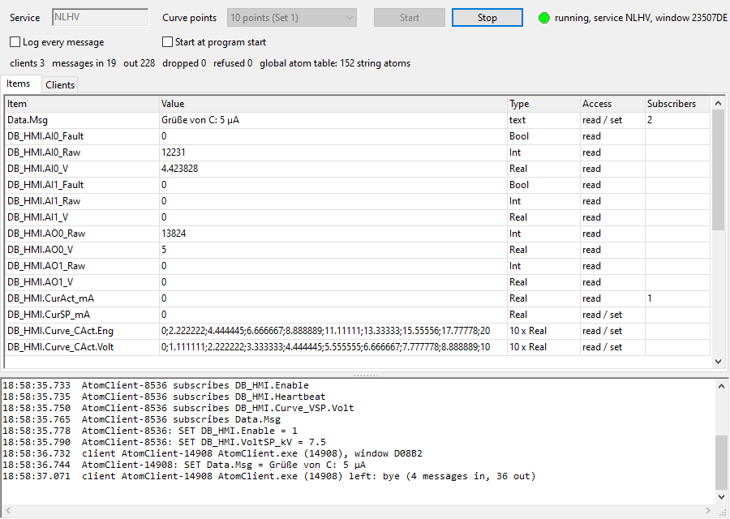

# Atom Server (Lazarus)

The simulated HV PLC for other programs on the same PC, through **Windows global atoms**, written in Free Pascal / Lazarus. It needs no DLL, no network and no library: only `GlobalAddAtom`, `PostMessage` and a message-only window. DDE passes its names the same way, but here the whole message is in the atom. The protocol is called **NLAtom/1**; [AtomClient](../AtomClient/README.md) speaks it, and so can any language that can call the Windows API (a Python example is below).

The PLC logic and the HV plant are the same as in [OpcUaSim](../OpcUaSim/README.md), [MqttSim](../MqttSim/README.md) and [DdeServer](../DdeServer/README.md) (`uplcsim.pas`).



## Build and run

Open `AtomServer.lpi` in Lazarus and press Run, or:

```bash
C:\lazarus\lazbuild.exe AtomServer\AtomServer.lpi
```

Set the **Service** (default `NLHV`) and the **Curve points** (10 = Set 1, 2 = Set 2), then press **Start** (`F5`).
- **Settings:** saved in `AtomServer.ini` next to the exe. *Start at program start*, or `--start`, starts the server at once, and `UpdateMs=100` is how often subscriptions are checked.
- **Same service twice:** a second server with the same service name is refused, and the log shows which program has it.
- **Window:**
  - the item table (value, type, access, number of subscribers);
  - the clients (name, program, window, messages in / out, subscriptions);
  - the log;
  - a status line with messages, dropped messages, refused commands, and the number of string atoms in the global atom table.

## How it works

| | |
|---|---|
| Server | a message-only window, class `NLAtomServer`, title = service name. Clients find it with `FindWindowEx(HWND_MESSAGE, 0, 'NLAtomServer', 'NLHV')` |
| Messages | `RegisterWindowMessage('NLAtom.Command.v1')` client → server, `'NLAtom.Reply.v1'` server → client; `wParam` = window of the sender, `lParam` = the atom |
| Text | one line in the atom, at most 255 characters: `<id> <COMMAND> <arguments>` |
| Id | `<window of the sender, hex>.<counter>`, for example `1D206D6.12`; a reply repeats it, an update from a subscription has `S.<counter>` |
| Ownership | the sender adds the atom (`GlobalAddAtom`), the receiver reads and deletes it (`GlobalDeleteAtom`). A failed `PostMessage` deletes it at once. A window that closes deletes the atoms still in its queue |

**Why the id:**
- Atoms ignore case, and the same text gives the same atom (with a reference count). Without a unique id, `SET Data.Note=Hello` and `SET data.note=hello` at the same moment would be one atom, and one of them would read the other's text.
- The id also tells a reply to which command it belongs.

**Why the atoms must be deleted:** the global atom table is shared by all programs of the Windows session and holds only about 16,000 strings. An atom that is never deleted stays until you log off. AtomClient has a tab that shows the table, to check this.

## Commands

| Command | Reply |
|---|---|
| `HELLO <client name>` | `WELCOME NLHV NLAtom/1 <number of items>` |
| `ITEMS [filter]` | one `ITEM <name> <type> <r\|rw>` per item, then `END <n>` |
| `GET <item>` | `VAL <item>=<value>` or `ERR <item> <reason>` |
| `SET <item>=<value>` | `OK <item>=<value now>` or `ERR <item> <reason>` |
| `SUB <item>` | `VAL` with the value now, then a `VAL` (id `S.n`) on every change |
| `UNSUB <item>` / `UNSUB *` | `OK` |
| `PING` | `PONG <server time>` |
| `BYE` | none: the client leaves |
| when the server stops | it sends `S.n BYE server stops` to every client |

**Clients:**
- **Registering:** a client is known from its first command; `HELLO` gives it a name.
- **Leaving:** a client whose window is gone (the program ended or crashed) is removed within 100 ms, and the server sends it nothing more.
- **Lost updates:** an update that can't be posted (queue full) is sent again with the next change.

## Items

| Item | Type | Access |
|---|---|---|
| `DB_HMI.VoltSP_kV`, `DB_HMI.CurSP_mA` | Real | read / set |
| `DB_HMI.VoltAct_kV`, `CurAct_mA`, `AO0_V` … `AI1_V`, `AO0_Raw` … `AI1_Raw`, `Heartbeat` | Real / Int | read |
| `DB_HMI.Enable` (`1` / `0`) | Bool | read / set |
| `DB_HMI.Valid_VSP` …, `AI0_Fault`, `AI1_Fault` | Bool | read |
| `DB_HMI.Curve_VSP.Eng`, `DB_HMI.Curve_VSP.Volt` (also `VAct`, `CSP`, `CAct`) | 10 or 2 Real, separated by `;` | read / set |
| `DB_HMI.Err_VSP` … (Set 2, set 0 = acknowledge), `VSP_Limited`, `CSP_Limited` | Int / Bool | read / set, read |
| `Sim.Counter`, `Sim.Sine`, `Sim.Toggle`, `Sim.Clock` (`2026-10-26T18:53:46.480`) | | read |
| `Data.<any name>`: `SET` or `SUB` makes it (up to 1000, text up to 200 characters) | text | read / set |

- **Names:** item names are not case sensitive.
- **Values:** numbers use `.`; `,` is accepted when writing. Booleans are `1` / `0` (`true`, `false`, `on`, `off` when writing).
- **PLC rules:** the next PLC cycle (50 ms) applies the same rules as the real PLC, for example Set 2's checks of the curves.

## From another language

The Python test client used for the tests (ctypes, about 150 lines) does the same as AtomClient:

```python
a = GlobalAddAtomW("%X.%d GET DB_HMI.VoltAct_kV" % (my_window, n))
PostMessageW(FindWindowExW(HWND_MESSAGE, None, "NLAtomServer", "NLHV"), CMD, my_window, a)
# in the window procedure: text = GlobalGetAtomNameW(lParam); GlobalDeleteAtom(lParam)
```

## Test that was run

- **Independent Python client** (its own message-only window):
  - `HELLO`, `PING`, `ITEMS` with a filter, and `GET` (also in lower case);
  - an unknown item, accepted and refused `SET`s, a read-only item;
  - writing a curve, and a curve with 3 values instead of 10;
  - `Data.Note` set to `Hello World` and then to `hello world`: the second value came back in its own case;
  - `Data.Größe = 5 µA ÄÖÜ`;
  - an unknown command;
  - `SUB` of two items (54 updates in 3 s), `UNSUB *` (no more updates), `BYE`.
- **Speed:** 2000 `GET`s at once all came back in 0.19 s, about 10,000 round trips per second.
- **AtomClient:**
  - 3 clients at once; `Data.Msg` went from one client to another;
  - the server killed and started again: the client found it again within 2 s and subscribed again;
  - 5 clients killed during subscriptions.
- **Global atom table:** 152 string atoms before and after every test, and no NLAtom message atom left.

## Files

```
AtomServer.lpi / .lpr       project
uatmain.pas / .lfm          main window (designer form)
uatomsrv.pas                the server: items, commands, subscriptions, clients
uatomproto.pas              NLAtom protocol: message-only window, PostAtom / TakeAtom,
                            the list of all global atoms (shared with ../AtomClient)
../OpcUaSim/uplcsim.pas     PLC logic (Set 1 / Set 2) and HV plant, 50 ms cycle thread
../DdeServer/ufrmsnap.pas   --snapshot=<png> --after=<s>: the window as a PNG (tests)
```
